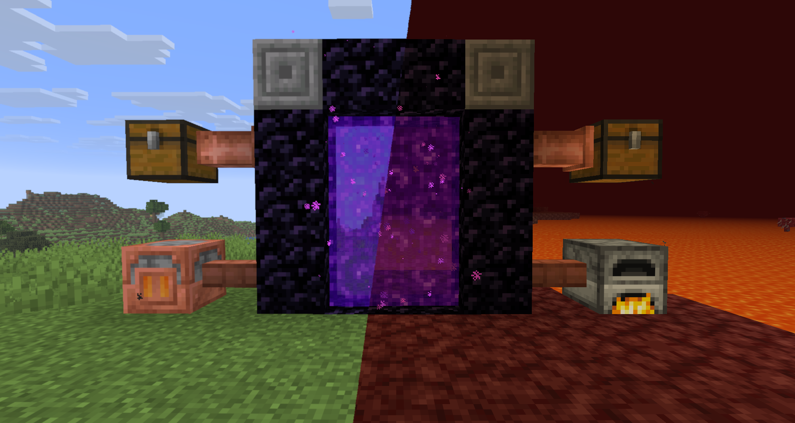

# Interdimensional Transfer Protocol

> _"To pack oneself like a beast of burden, or to hurl cast-iron carts into swirling portals, is a primitive, crude, and, if I may, rude way to trade across realms. The obsidian frames bind the way, and in doing so, open another."_
>
> — **Uncredited**, from the transcript of a public debate in the **Hall of Enlightenment**

The **Interdimensional Transfer Protocol (ITP)** turns the volcanic glass framing portals to the Netherworld into stateless relays able to move items, fluids, and even raw energy across realms.

Where wayfarers once endured overburdened trips, cluttered item streams, or volatile rails, **ITP** allows us to bind our hoppers and pipes directly to the outer sides of the obsidian frame. The binding glass acts as a cross-dimensional bridge, effortlessly displacing what it's bound to receive into whatever containers or pipes await on the other side.

## Tenets

+ _Obsidian binds, but does not store._

  Matter and energy flow through the frame, but never linger inside it. If no vessel awaits on the other side, the obsidian refuses them.

+ _The portal swirls, the world breathes._

  Items live preserved inside their vessels. None are loosened to decay, and the world keeps on flowing seamlessly.

+ _Eight steps here, one step there._

  To cross the realms is to fold space eight times. Even the binding glass cannot escape this geometry.

## Frailties

+ _Portals do not have eyes, but they must see._

  It has been observed again and again that portions of the world seemingly cease to exist when unobserved. If either end of a portal lies in one of these absences, no transaction can happen.

  Other magicians may have already solved this conundrum, so consult their works.

+ _Nothing to bind, nothing to transfer._

  The obsidian frame draws its bridging property from the lit portal it binds. Dispelling the portal halts any displacement until it gets rekindled.

+ _Where wares flow._

  Not all sides of the obsidian frame are the same. Bind conduits to the top, and the frame will search for vessels below the other portal. Bind conduits to the bottom, and it will search above the other. Bind either left or right, and it will search both left and right on the other side. But don't try to bind anything before or behind the frame, for nothing will work.
